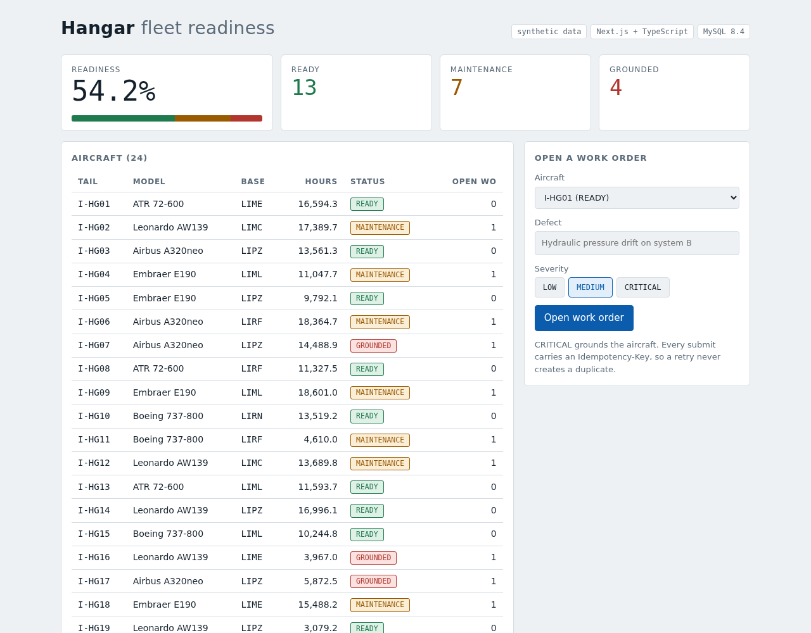

# Hangar

A small fleet readiness dashboard. Next.js 15, TypeScript in strict mode, MySQL 8.4.
It is a demo built in an afternoon to show how I structure a full stack service, so the data is synthetic and there is no auth.



## Run it

Needs Node 20+, pnpm and Docker.

```bash
pnpm install
pnpm db:up        # MySQL 8.4 on port 3307, plus a separate hangar_test database
pnpm db:reset     # apply migrations, load 24 aircraft, 6000 flights, 20 work orders
pnpm dev          # http://localhost:3000
```

```bash
pnpm test         # 27 tests: unit, plus integration against a real MySQL
pnpm typecheck
pnpm build
```

Connection strings live in `.env.example`. Tests run against `hangar_test` and refuse to start against any other database.

## What it shows

**Idempotent writes.** `POST /api/work-orders` accepts an `Idempotency-Key` header. A retry with the same key returns the original result (`200`, `Idempotent-Replayed: true`) and never creates a second row. The same key with a different body is a `422`. The UI sends a fresh key per submit and has a "Resend last request" button to show it.

**One transaction, one lock.** Opening a work order inserts the row and updates the aircraft status together. The aircraft row is read `FOR UPDATE`, so two requests for the same aircraft serialize. If two requests race with the same key, the `UNIQUE` index decides the winner and the loser reads the winner's row. A test fires five concurrent requests with one key and asserts exactly one row.

**Keyset pagination.** `GET /api/flights` pages with a cursor on `(departed_at, id)` instead of `OFFSET`. Cost stays flat on page 500 and new rows do not shift pages. The row-value comparison is served by `idx_flights_departed`.

**Indexes you can see.** The bottom panel runs `EXPLAIN` live for "recent flights of one aircraft", once as written and once with the indexes ignored. On the seeded data: about 255 rows examined with `idx_flights_aircraft_departed`, about 5,980 and a filesort without it.

**Validation at the boundary.** TypeScript types disappear at runtime, so every request is parsed with Zod. All errors share one shape: `{ error: { code, message, details? } }`.

**Small decisions.** All `DATETIME` columns hold UTC and are read back as strings, so no implicit timezone conversion. `utf8mb4` everywhere. A single pool per process, kept across hot reloads. Domain rules (`summarizeFleet`, `statusAfterWorkOrder`) are pure functions in `src/lib/domain.ts`, tested without a database.

## API

| Method | Path | Notes |
| --- | --- | --- |
| GET | `/api/fleet` | Aircraft list and readiness summary |
| GET | `/api/flights?limit=&cursor=` | Keyset pagination, `nextCursor` is null at the end |
| POST | `/api/work-orders` | `{ aircraftId, title, severity }`, optional `Idempotency-Key` (UUID) |
| GET | `/api/explain?aircraftId=` | Live `EXPLAIN` output for the recent flights query |

## Limits, on purpose

No authentication or roles, no rate limiting, no CI config, and the aircraft list is not paginated because the fleet is small. Migrations are plain SQL files applied in order; MySQL commits DDL implicitly, so a migration is not atomic. With more time I would add auth, structured logging, a CI workflow that runs the integration tests against a service container, and a query builder such as Kysely for typed SQL.
